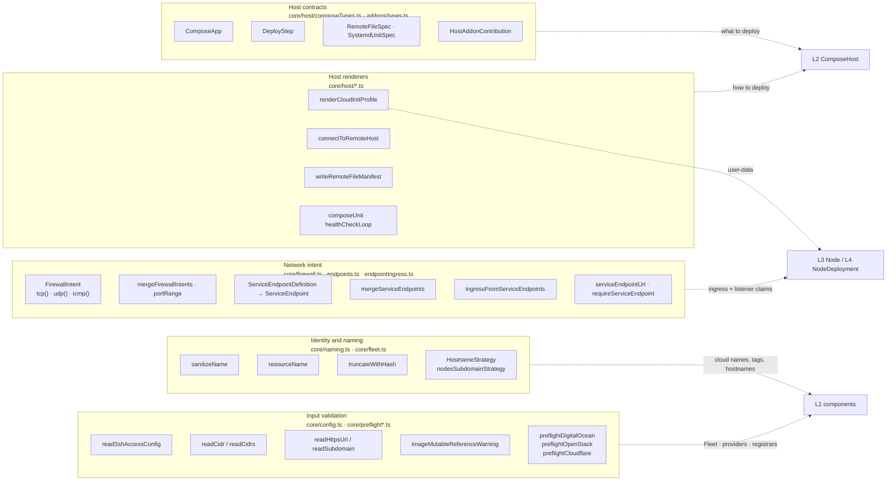
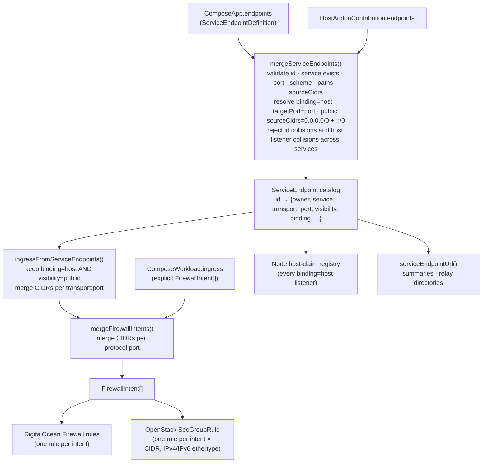
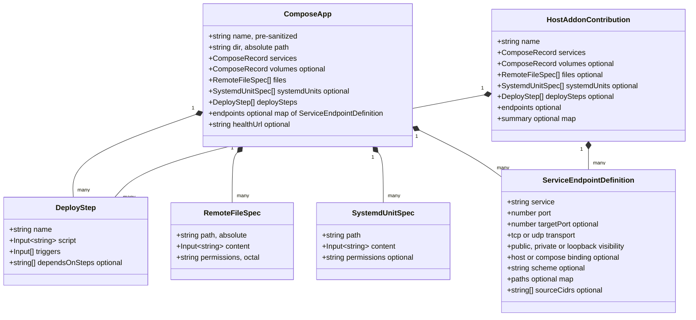
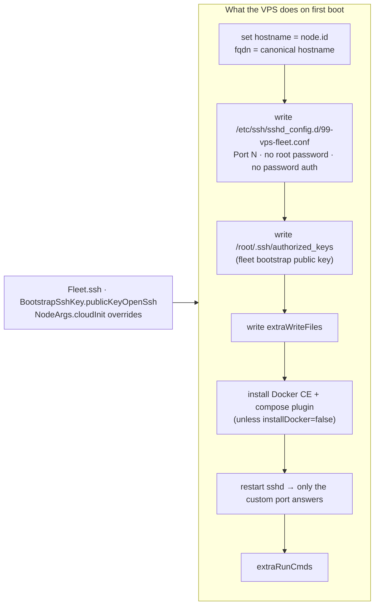

# L0 — Primitives and contracts

> **Zoom:** [↑ L1 Leaf components](./02-leaf-components.md) · [⌂ Index](./README.md)

Nothing on this page is a Pulumi `ComponentResource`. These are the values,
validators, and renderers that every higher level is built from. Most of the
library's safety checks live here, and they run while the program is evaluated, before
any cloud API is called.

---

## 1. Identity and naming

All cloud-visible names go through `sanitizeName`. It lowercases the input, collapses
anything outside `[a-z0-9-]` into `-`, and trims leading and trailing dashes.
`resourceName(...parts)` joins the non-empty parts with `-` and sanitizes the result.
`truncateWithHash(value, max)` keeps a name within a provider limit by appending an
8-character SHA-256 suffix, so truncated names stay unique and stable.

The table below lists every name the library derives. `machineName` is the `Node`
component name, and `node.id` is its logical ID, which defaults to the same value.

| What                                | Derived as                                                        | Where                     |
| ----------------------------------- | ----------------------------------------------------------------- | ------------------------- |
| Workload hostname                   | `fleet.hostnameFor(node, domain)`. Default: `<node.id>.nodes.<domain>` | `Fleet`             |
| Machine canonical FQDN              | `Node.hostname` arg, else the first attached workload hostname    | `Node`                    |
| Droplet / instance name             | `truncateWithHash(<prefix>-<env>-<machineName>, 64 \| 63)`        | DO / OpenStack provider   |
| Cloud tags                          | `<prefix>`, `<prefix>-<env>`, `<prefix>-<machineName>`            | `Fleet.tagsFor`           |
| DO bootstrap key                    | `<prefix>-<env>-<providerName>-bootstrap`                         | `DigitalOceanProvider`    |
| OpenStack key pair                  | `<prefix>-<env>-<providerName>-<region>-bootstrap`                | `OpenStackProvider`       |
| SSH alias                           | `<prefix>-<workload>-<node.id>`                                   | `NodeDeployment`          |
| Mesh connector name                 | `<prefix>-<env>-<hostname>`                                       | `CloudflareMeshAddon`     |
| MoQ cluster `id`                    | `stableClusterId(node.id)`: 53-bit integer from SHA-256            | `moq/cluster.ts`          |

Pulumi resource names follow a parallel scheme. Each level lists them where it creates
them, and [L6](./07-fleet.md#ownership-tree-pulumi-parentage) collects them all.

## 2. Input validation

Validators throw before any resources are registered. A misconfigured stack therefore
fails during `pulumi preview`, not halfway through `up`.

| Validator                          | Rejects                                                                                 |
| ---------------------------------- | --------------------------------------------------------------------------------------- |
| `readSshAccessConfig`              | Port 22, out-of-range ports. Empty `allowedCidrs` becomes `0.0.0.0/0`. Default port 2222. |
| `readCidr` / `readCidrs`           | Placeholders (`REPLACE_WITH`, `<...>`, `TODO`), bad address family/prefix. Dedupes.      |
| `readHttpsUrl`                     | Non-HTTPS URLs and embedded credentials. Trailing `/` stripped.                         |
| `readSubdomain`                    | Anything other than a single lowercase DNS label.                                        |
| `imageMutableReferenceWarning`     | Not a failure: *warns* when an image has neither a tag nor a digest.                     |
| `preflightDigitalOcean`            | Missing `DIGITALOCEAN_TOKEN` / `digitalocean:token`. Skipped when explicit `providers` are passed. |
| `preflightOpenStack`               | Missing `OS_AUTH_URL`, `OS_REGION_NAME`, or a complete app or password credential.       |
| `preflightCloudflare`              | Missing `CLOUDFLARE_API_TOKEN` / `CLOUDFLARE_DNS_API_TOKEN` / `cloudflare:apiToken`.     |

Preflight looks up values in this order: explicit `config`, then the supplied `env`,
then `process.env`. Pass `skipPreflight: true` to disable it.

## 3. Network intent: from endpoints to firewall rules

Applications never write firewall rules directly. They declare **endpoints**, and the
library derives ingress from them. This is the most important data flow in the library.

Visibility and binding together decide what happens to an endpoint:

| `binding` | `visibility` | Cloud firewall opened? | Claims a host listener on the Node? | `sourceCidrs` allowed? |
| --------- | ------------ | ---------------------- | ----------------------------------- | ---------------------- |
| `host`    | `public`     | **yes**                | yes                                 | yes (default any)      |
| `host`    | `private`    | no                     | yes                                 | no                     |
| `host`    | `loopback`   | no                     | yes                                 | no                     |
| `compose` | any          | no                     | no                                  | only if public; ignored |

`private` and `loopback` are labels. The library does not control the address a process
binds to. These endpoints are unreachable from outside only because the cloud firewall
opens nothing for them. Services that use `network_mode: host` must still declare every
listener, so the Node can detect port collisions between workloads.

The firewall helpers `tcp(port, cidrs?)`, `udp(port, cidrs?)`, and `icmp(cidrs?)` build
validated `FirewallIntent`s. `port` can be a number or `{from, to}`. If no CIDRs are
given, the default is `0.0.0.0/0` and `::/0`. Both providers default egress to
"everything": TCP 1–65535, UDP 1–65535, and ICMP to any destination.

## 4. Host contracts

These interfaces are the declarative input to [`ComposeHost`](./03-compose-host.md). An
application is a `ComposeApp`. An addon returns a `HostAddonContribution`, which is a
`ComposeApp` without its own name or directory, plus summary data.

Two template rules apply across all of these:

- The token `{{composeFile}}` in file contents, unit contents, or step scripts is
  replaced with `<dir>/docker-compose.yml`.
- `DeployStep.triggers` controls when a step re-runs. A step re-runs only when one of
  its triggers changes. This is how relays separate "new image or config" from
  "renewed certificate" ([L2](./03-compose-host.md#deploy-steps-and-triggers)).

## 5. Host renderers

### Cloud-init profile

`renderCloudInitProfile` creates a `cloudinit.Config` resource. Its `rendered` output
becomes the machine's user data. Each `Node` renders its own profile on first
attachment.

### Remote execution

These helpers turn host contracts into `@pulumi/command` remote commands. They are the
raw material for [`ComposeHost`](./03-compose-host.md).

| Helper                     | Produces                                                                                       |
| -------------------------- | ---------------------------------------------------------------------------------------------- |
| `connectToRemoteHost`      | A `<name>-wait-cloud-init` command (`cloud-init status --wait`) plus the SSH connection used by later commands. Sets `needsSudo` when the deploy user is not root. |
| `writeRemoteFileManifest`  | **One** command that writes every file as a base64 heredoc, creates parent directories, and sets `chmod`. Re-runs when any file's content changes. |
| `asRemoteScript`           | Wraps a script in `sudo /bin/sh -s` for non-root users (OpenStack `ubuntu`).                   |
| `composeUnit`              | A oneshot systemd unit that runs `docker compose pull` / `up -d` / `stop` for the listed services, so they come back after reboot. |
| `healthCheckLoop`          | A shell `curl` retry loop (default 30 × 1 s). It can also grep a second URL for a pattern and dump logs on failure. |
