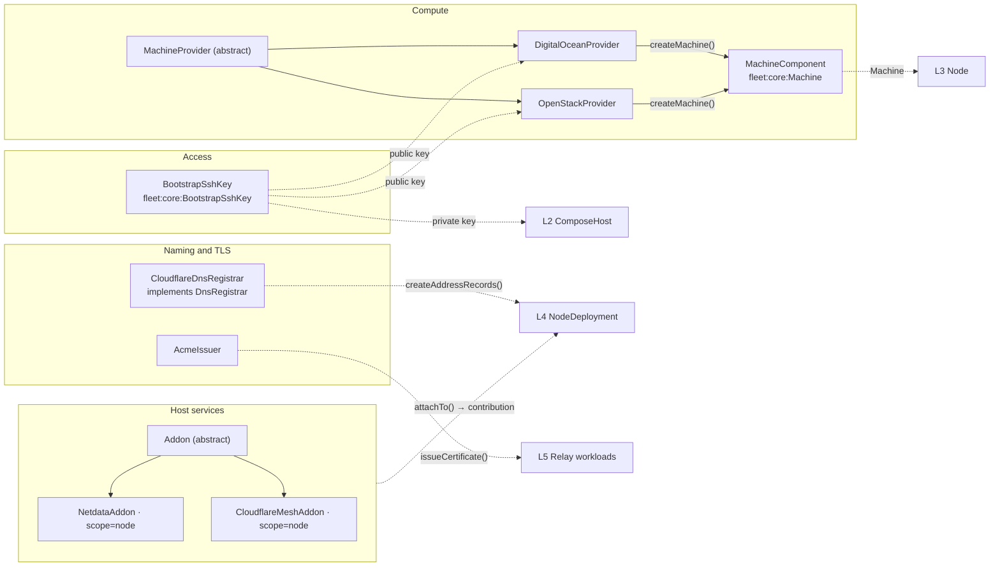
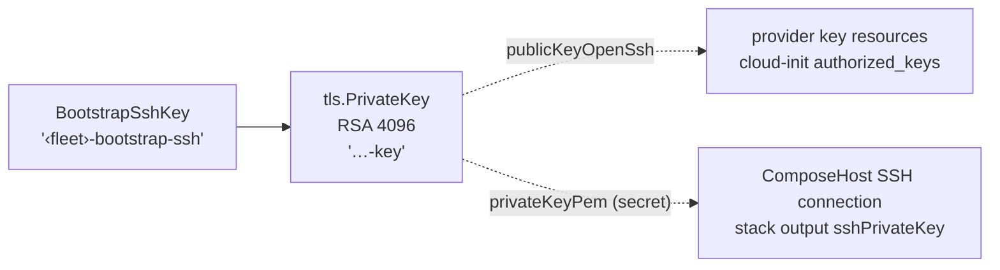
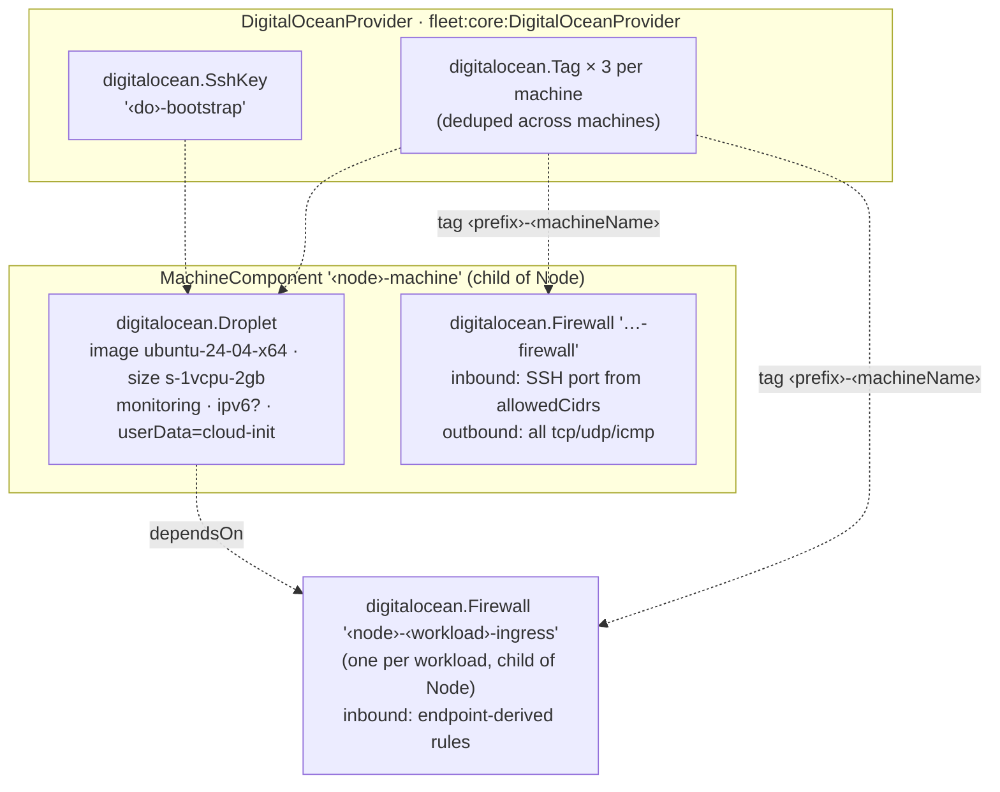
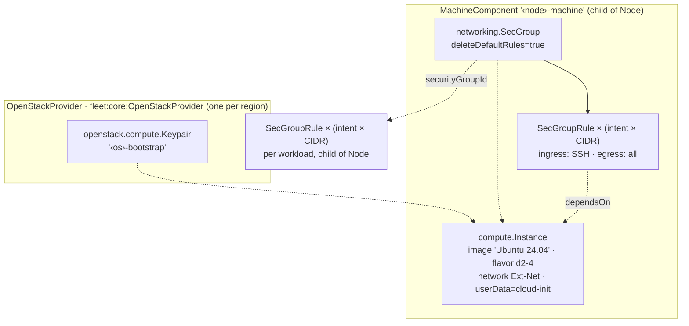
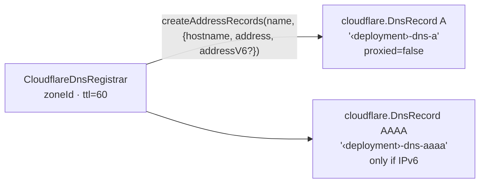
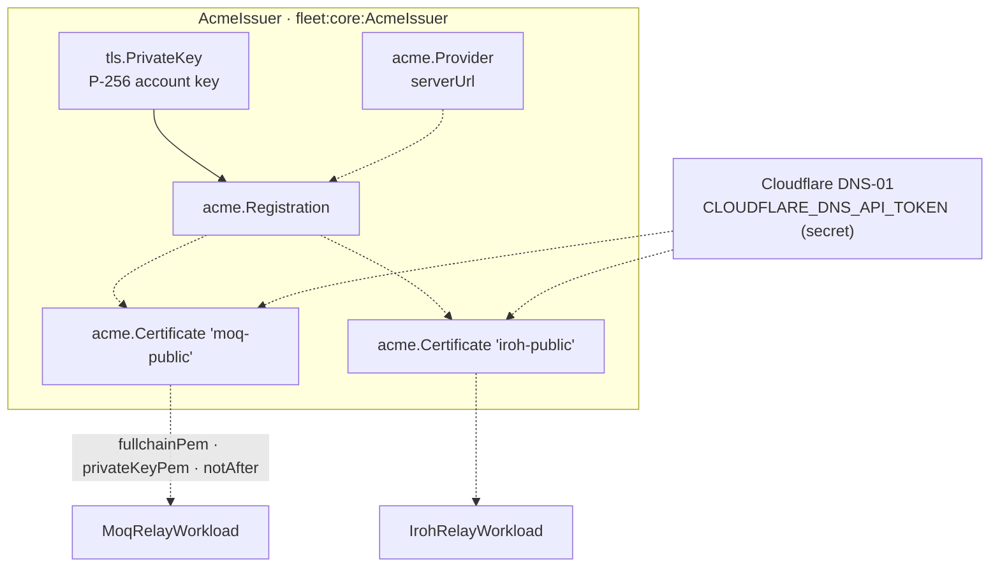
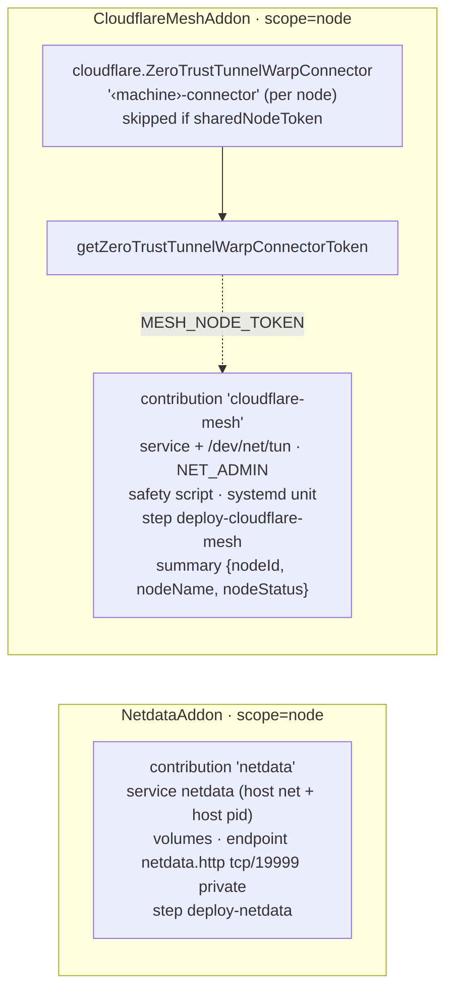

# L1 — Leaf components

> **Zoom:** [↓ L0 Primitives](./01-primitives.md) · [↑ L2 ComposeHost](./03-compose-host.md) · [⌂ Index](./README.md)

A leaf component is a Pulumi `ComponentResource` that contains only raw provider
resources (TLS keys, droplets, DNS records, and so on), not other library components.
Each one wraps a single concern and is handed to higher levels as a dependency.

Each component below shows what it creates (solid lines), the Pulumi resource names it
uses, and what it exposes.

---

## BootstrapSshKey

`Fleet` creates exactly one, as its child. It is the only credential that can SSH into
machines; there is no per-node key.

## MachineProvider → MachineComponent

`MachineProvider` is the adapter boundary between the provider-neutral world
(`MachineArgs`, `FirewallIntent`) and a specific cloud. A provider's
`createMachine(name, args, {parent: node})` returns a `MachineComponent` that wraps the
cloud-specific resources and implements the `Machine` interface:

| `Machine` member    | Purpose                                                                               |
| ------------------- | ------------------------------------------------------------------------------------- |
| `address`           | IPv4 address, used for SSH, DNS A records, summaries                                   |
| `addressV6?`        | IPv6 address, only when `Node.enableIpv6`; becomes AAAA records                        |
| `sshUsers`          | `{cloudInit, deployment}`: `root` on DigitalOcean, `ubuntu` (+sudo) on OpenStack      |
| `resource`          | The real cloud resource; `ComposeHost` waits on it                                     |
| `addIngress()`      | Adds more firewall policy to the **existing** machine; called once per workload       |

### DigitalOceanProvider

A single DigitalOcean provider can serve any number of regions, because the droplet
region comes from `Node.providerRegion`. Firewalls attach by **tag**, so each workload's
ingress is a separate `Firewall` resource that targets the same droplet. If a workload
has no public endpoints, it creates no firewall.

### OpenStackProvider

An OpenStack provider is pinned to one region and rejects nodes in any other, so a
multi-region OpenStack fleet needs one provider component per region. Each
`FirewallIntent` expands into one rule per CIDR, with `IPv4` or `IPv6` ethertype chosen
from the CIDR.

## CloudflareDnsRegistrar

The registrar owns no resources of its own. Records are parented to the calling
`NodeDeployment`, so deleting a workload removes its DNS records. Any object that
implements the `DnsRegistrar` interface can replace it.

## AcmeIssuer

`issueCertificate()` adds a certificate as a child of the issuer. Each relay workload
requests one certificate for `<domain>`, `nodes.<domain>`, and `*.nodes.<domain>`. One
certificate covers every node in the workload. With `minDaysRemaining: 30` (the
default), any `pulumi up` within 30 days of expiry renews it.

## Addons

An `Addon` is created once with `new` and then attached to any number of nodes through
workloads. `attachTo(context)` returns a `HostAddonContribution`
([L0](./01-primitives.md#4-host-contracts)). Any per-node cloud resources the addon
needs are created as **children of the addon**.

| Scope      | Where it's deployed                                                          | Dedup rule                                       |
| ---------- | ---------------------------------------------------------------------------- | ------------------------------------------------ |
| `node`     | Its own Compose project at `/opt/vps-fleet/addons/<name>`, parented to Node  | Same addon **instance** → deployed once per node |
| `workload` | Merged into each workload's Compose project                                  | Deployed with every workload                     |

Both built-in addons are node-scoped. Reuse one instance across workloads so a shared
node gets a single Netdata and a single Mesh connector. The deduplication is
implemented by the Node ([L3](./04-node.md#node-scoped-addon-deduplication)).
