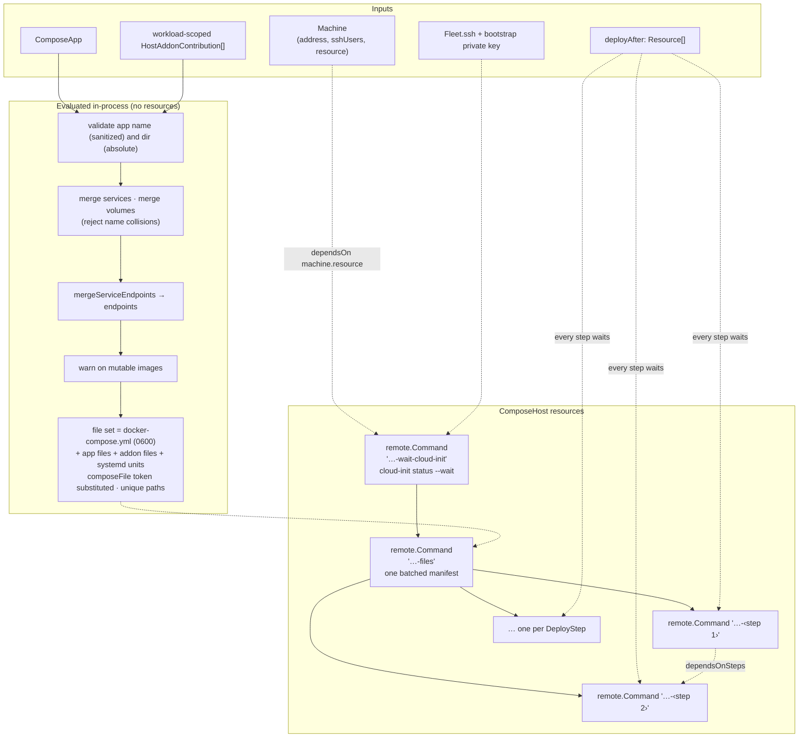
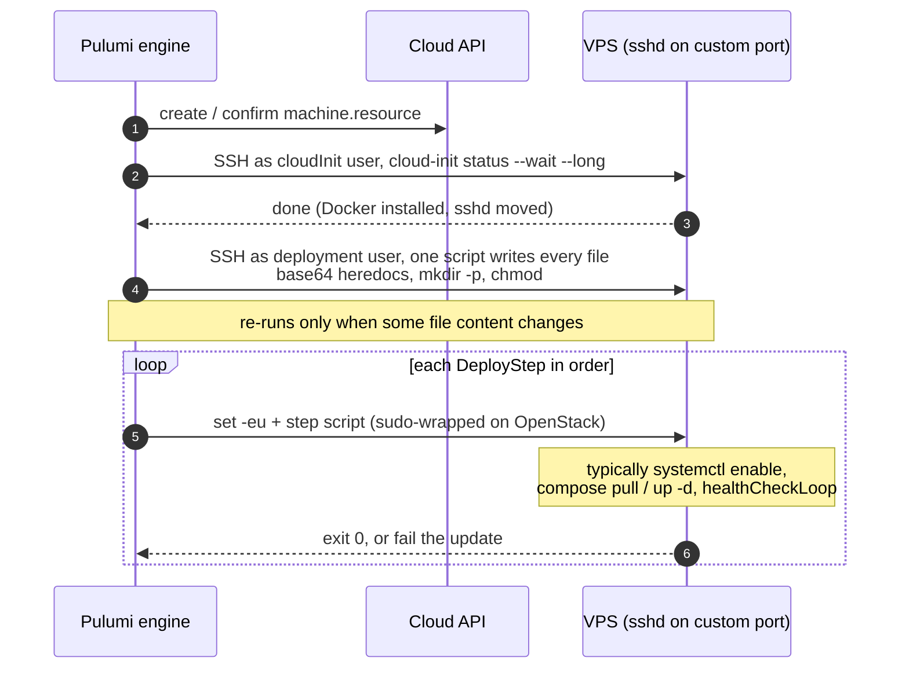
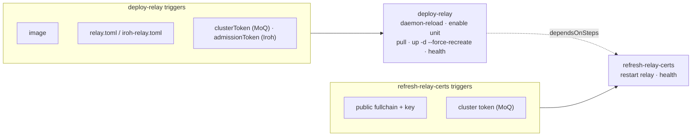

# L2 — ComposeHost

> **Zoom:** [↓ L1 Leaf components](./02-leaf-components.md) · [↑ L3 Node](./04-node.md) · [⌂ Index](./README.md)

`ComposeHost` (`fleet:core:ComposeHost`) is the unit of **remote deployment**: one
Docker Compose project, written to one machine over SSH, then started by named
deploy steps. Every container the library runs is deployed through a ComposeHost.

There are two kinds of ComposeHost on a node:

| Kind              | Pulumi name                           | Parent           | Contents                                       |
| ----------------- | ------------------------------------- | ---------------- | ---------------------------------------------- |
| Workload host     | `<workload>-<node.id>-host`           | `NodeDeployment` | Workload `ComposeApp` + workload-scoped addons |
| Node addon host   | `<machineName>-<addon>-addon-host`    | `Node`           | One node-scoped addon, as its own `ComposeApp` |

## What it's made of



Steps run in this order: **workload-scoped addon steps first, then the app's steps**.
A step can only depend on steps declared earlier, so `dependsOnSteps` cannot form a
cycle. Forward or unknown references fail at evaluation time.

`completionResources` is the full list of step commands. Higher levels use it as the
"this host is deployed and healthy" barrier for serial rollouts and node chaining
([L3](./04-node.md#deploy-chaining), [L5](./06-workloads.md#rollout)).

## A deploy, end to end



## Deploy steps and triggers

`remote.Command` runs its script on **create** and whenever its **triggers** change.
Changing only a step's script text does not re-run it. Each app therefore decides what
should cause a restart. The relay apps define two steps:



The **file manifest** is a separate trigger boundary. A certificate renewal rewrites the
certificate files, because the manifest's triggers are every file's content, and then
runs only `refresh-relay-certs`. The image and configuration are not touched.

## What lands on the machine

```text
/opt/<app>/docker-compose.yml        0600  generated from merged services + volumes
/opt/<app>/...                        app files (configs, certs, secrets)
/etc/systemd/system/<app>.service     composeUnit(): pull + up -d at boot
/opt/vps-fleet/addons/<addon>/docker-compose.yml   node addon hosts
/usr/local/sbin/fleet-cloudflare-mesh-safety      Mesh addon only
```

The relay layouts at this level:

| App    | Dir         | Files                                                                                         | Unit           |
| ------ | ----------- | --------------------------------------------------------------------------------------------- | -------------- |
| `moq`  | `/opt/moq`  | `relay.toml`, `certs/public/node/{fullchain,privkey}.pem`, `secrets/cluster-token` | `moq.service`  |
| `iroh` | `/opt/iroh` | `iroh-relay.toml`, `certs/{fullchain,privkey}.pem`                                            | `iroh.service` |

## Safety checks at this level

The constructor throws on any of the following:

- invalid app name or a relative `dir`
- duplicate Compose service or volume names between the app and its addons
- duplicate remote file paths
- duplicate or invalid deploy-step names, or `dependsOnSteps` that point forward or to unknown steps
- endpoint problems from `mergeServiceEndpoints` ([L0](./01-primitives.md#3-network-intent-from-endpoints-to-firewall-rules))

These checks only cover **one** Compose project. Collisions *between* projects on the
same machine are the Node's job (next level).
