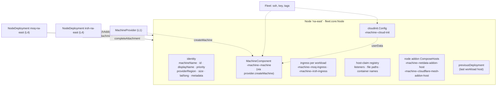
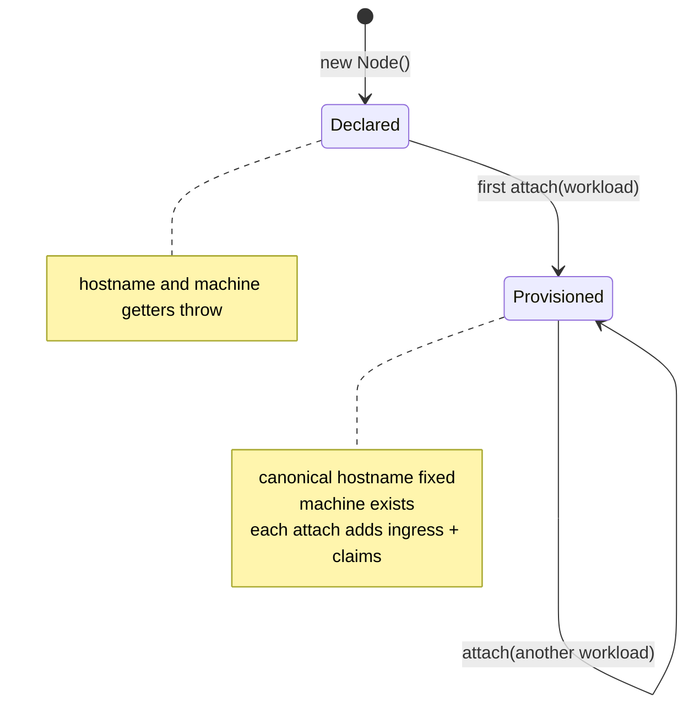
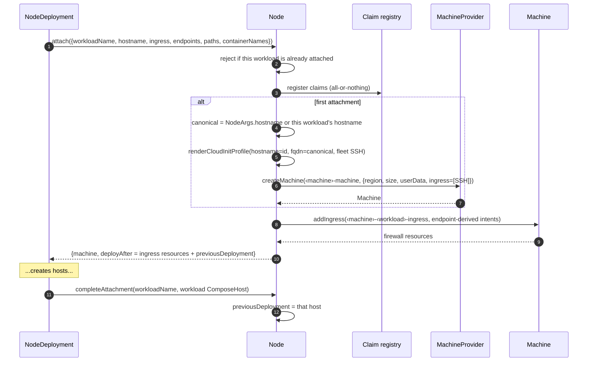
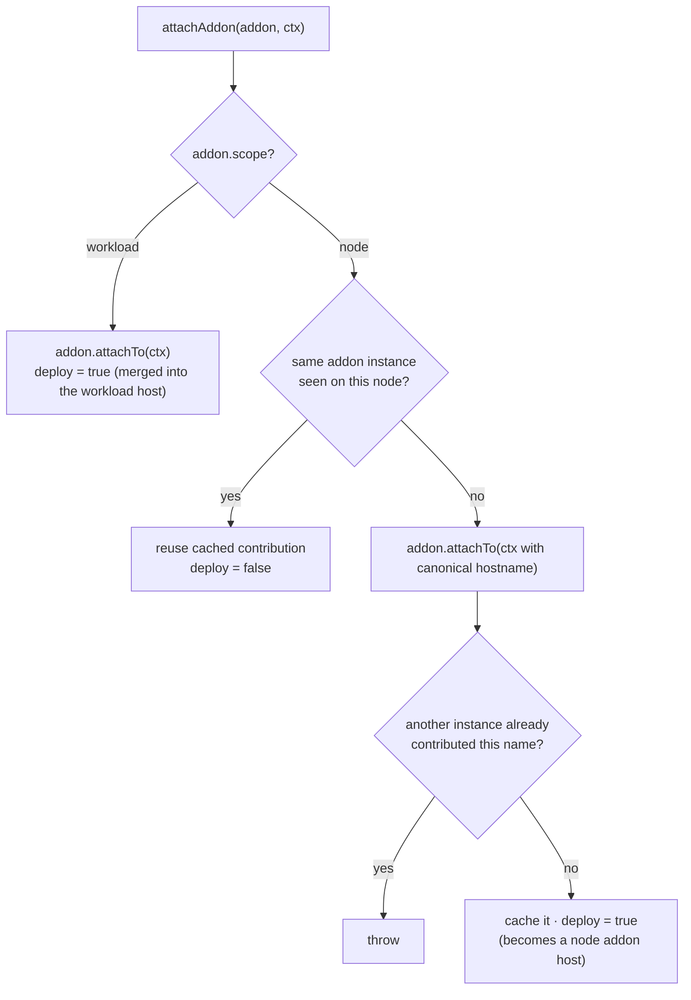
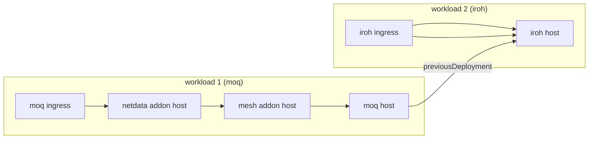
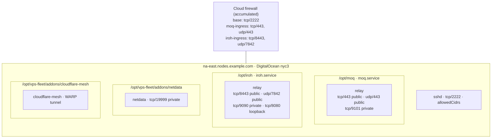

# L3 — Node

> **Zoom:** [↓ L2 ComposeHost](./03-compose-host.md) · [↑ L4 NodeDeployment](./05-node-deployment.md) · [⌂ Index](./README.md)

A `Node` (`fleet:core:Node`) is the logical identity of **one machine** and the
arbiter between everything that runs on it. It is the point where workloads, which
want things, meet providers, which make things.

## Lifecycle: lazy provisioning

Creating a `Node` creates no cloud resources. The first workload that **attaches**
triggers cloud-init rendering and machine creation. Each later attachment only adds
firewall policy and host claims.

**The canonical hostname matters.** It becomes the machine's FQDN in cloud-init and is
fixed at first attach. If two workloads with different domains share a node, set
`NodeArgs.hostname` explicitly. Otherwise the machine's identity depends on which
workload happens to be constructed first.

## Host-claim registry

Several Compose projects share one kernel, one set of ports, and one filesystem. The
Node is the only place that sees all of them, so it rejects collisions **across
workloads**:

| Claim            | Key                       | Collected from                                                          |
| ---------------- | ------------------------- | ----------------------------------------------------------------------- |
| Host listener    | `transport:port`          | every endpoint with `binding: host`, any visibility                     |
| Remote file path | absolute path             | compose file, app files, systemd units, addon files and units           |
| Container name   | `container_name` value    | services that set `container_name` explicitly                           |

Registration is atomic per workload: every claim is checked before any is committed.
The error names both workloads, for example `Host listener collision on "tcp:443"
between workload "moq" (endpoint "moq.https") and workload "iroh" (endpoint
"iroh.https")`.

## Node-scoped addon deduplication

`attachAddon(addon, context)` is the Node's second role:

As a result, Netdata and Mesh are deployed once per machine, by whichever workload
attaches first, and the summaries of every later workload still include their
contribution.

## Deploy chaining

Workloads that share a node should not run `systemctl` and `docker compose` changes at
the same time. The Node threads one dependency chain through every deployment on the
machine:

What the chain gates: `deployAfter` is applied to a ComposeHost's **deploy-step
commands only** ([L2](./03-compose-host.md#what-its-made-of)). Each host's
`wait-cloud-init` and file-manifest commands depend only on the machine. So the
`iroh` host can write its files, including its systemd unit, while `moq`'s steps are
still running. Steps never overlap. Because projects live in disjoint directories and
the claim registry forbids shared paths, those concurrent writes never touch the same
file.

The chain follows **construction order** in your Pulumi program. It does not use
priority or name. Different nodes are never chained by the Node; only serial rollout
does that ([L5](./06-workloads.md#rollout)).

## A shared node, fully assembled

This is the `na-east` node from the [L6 example](./07-fleet.md), running both relays
and both addons:

| Listener   | Owner                      | Visibility | Firewall |
| ---------- | -------------------------- | ---------- | -------- |
| tcp/2222   | sshd (cloud-init)          | allowedCidrs | base machine firewall |
| tcp/443    | `moq.https`                | public     | `…-moq-ingress`  |
| udp/443    | `moq.webtransport`         | public     | `…-moq-ingress`  |
| tcp/9101   | `moq.prometheus`           | private    | closed   |
| tcp/8443   | `iroh.https` (moved off 443) | public   | `…-iroh-ingress` |
| udp/7842   | `iroh.quic-discovery`      | public     | `…-iroh-ingress` |
| tcp/9090   | `iroh.metrics`             | private    | closed   |
| tcp/8080   | `iroh.http`                | loopback   | closed   |
| tcp/19999  | `netdata.http`             | private    | closed   |

If you leave Iroh on its default tcp/443, the claim registry throws when the Iroh
workload attaches, because the MoQ relay already owns tcp/443.

## Ownership note

The Node is the Pulumi parent of its cloud-init config, its `MachineComponent` (and
through it the droplet or instance), every per-workload ingress resource, and every
node addon ComposeHost. Destroying a workload removes its own ingress rules and host.
The machine stays as long as any workload still references the node.
