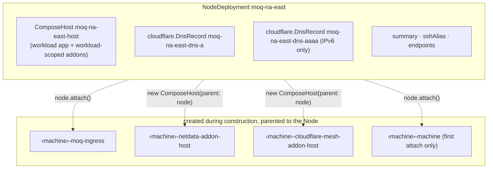
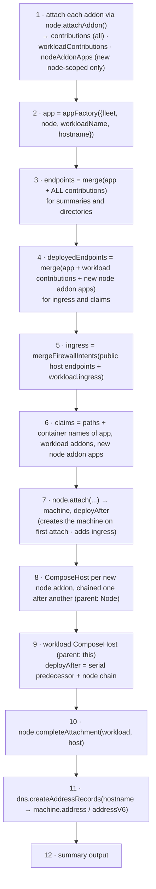
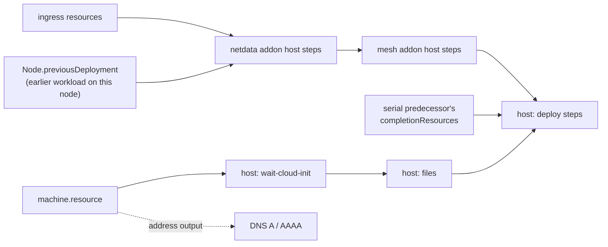

# L4 — NodeDeployment

> **Zoom:** [↓ L3 Node](./04-node.md) · [↑ L5 Workloads](./06-workloads.md) · [⌂ Index](./README.md)

A `NodeDeployment` (`fleet:core:NodeDeployment`) is **one workload on one node**, a
single cell in the workload × node grid. It is the level where every lower piece is
assembled: addons ([L1](./02-leaf-components.md#addons)), the app contract and endpoint
pipeline ([L0](./01-primitives.md)), the Node ([L3](./04-node.md)), ComposeHosts
([L2](./03-compose-host.md)), and DNS ([L1](./02-leaf-components.md#cloudflarednsregistrar)).

Pulumi name: `<workload>-<node.id>`, for example `moq-na-east`.

## What it's made of



Some resources this deployment causes to exist are **owned by the Node**, not by the
deployment. This is what lets a machine and its shared addons outlive any single
workload.

## The construction pipeline

Everything below runs synchronously in the constructor, in this order:



### Why there are two endpoint catalogs

| Catalog               | Includes reused node addons? | Used for                                             |
| --------------------- | ---------------------------- | ---------------------------------------------------- |
| `endpoints`           | **yes**                      | `summary.endpoints`, MoQ/Iroh directories            |
| `deployedEndpoints`   | no (only ones this deployment deploys) | firewall ingress, Node listener claims     |

The second workload on a shared node still *reports* `netdata.http`, but does not claim
tcp/19999 again. Claiming it twice would collide with the first workload's claim on
the same listener.

## Dependency graph of one deployment



DNS records depend only on the machine's address. **They are not gated on health
checks.** A hostname can resolve before its relay passes `healthCheckLoop`. With
`ttl: 60` and an unproxied record, clients may reach the new IP during the first
deploy before the service is ready.

## Summary and SSH alias

```ts
// NodeDeployment.summary
{
  id, provider, providerRegion, priority,
  hostname,            // workload hostname, not necessarily the machine FQDN
  address, addressV6?,
  healthUrl?,          // from ComposeApp.healthUrl
  endpoints,           // full catalog incl. reused node addons
  mesh?: { nodeId, nodeName, status }   // when a 'cloudflare-mesh' contribution exists
}
// NodeDeployment.sshAlias → "<prefix>-<workload>-<node.id>"
```

Two deployments on the same machine produce two SSH aliases (`edge-moq-na-east` and
`edge-iroh-na-east`) that point at the same address.

## Using it directly

Construct `NodeDeployment` directly only when you need a single cell without
`ComposeWorkload`'s fleet-membership check, priority ordering, hostname uniqueness,
serial rollout, and aggregation. In every other case, let a workload create it.
