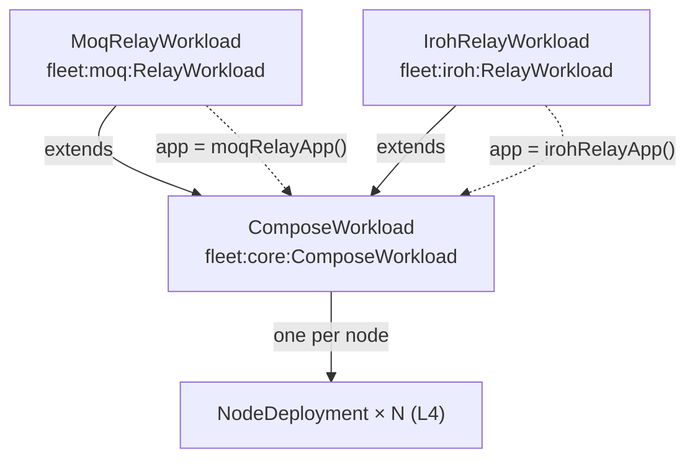
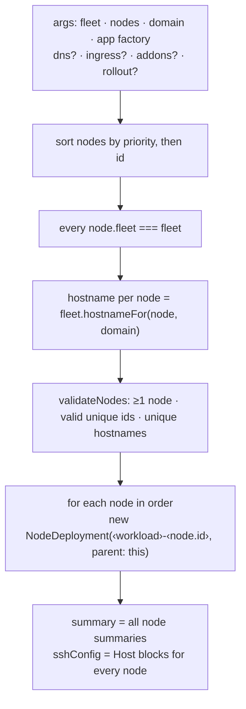
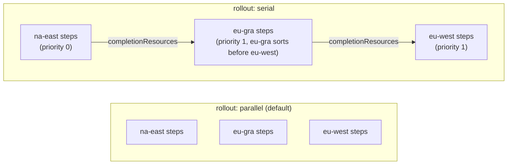
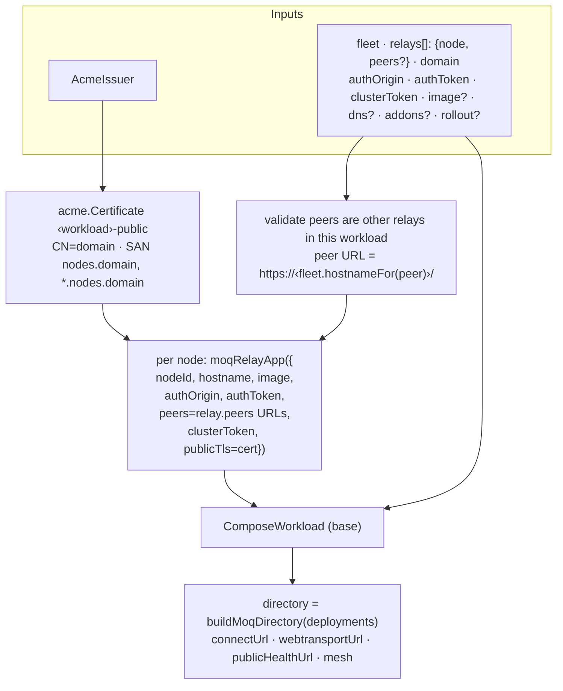
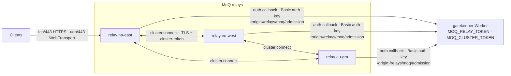
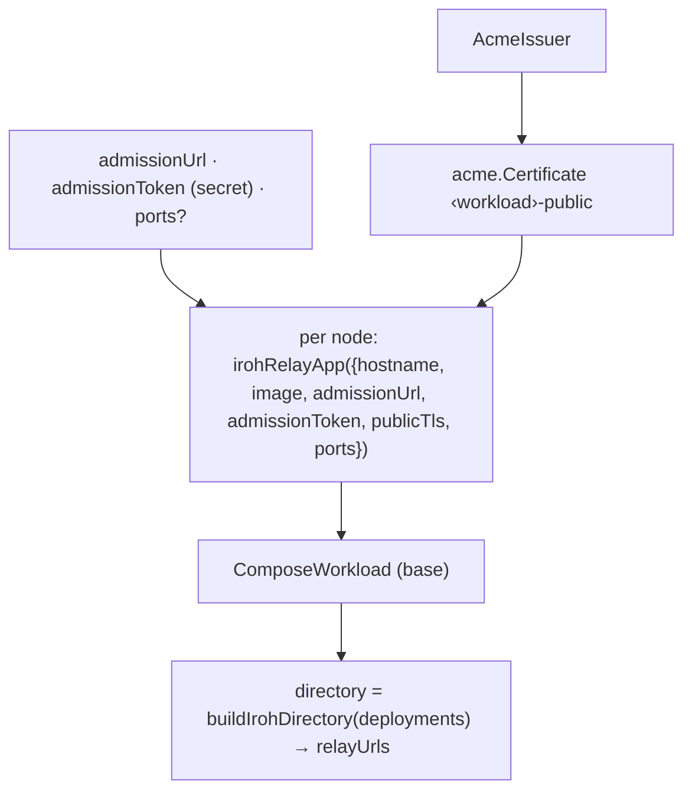
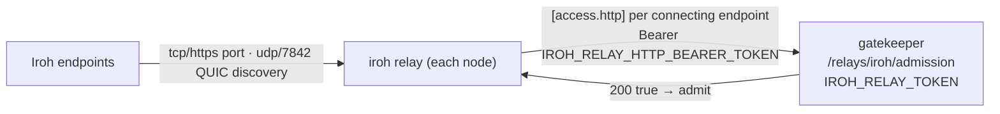

# L5 — Workloads

> **Zoom:** [↓ L4 NodeDeployment](./05-node-deployment.md) · [↑ L6 Fleet](./07-fleet.md) · [⌂ Index](./README.md)

A workload is **one application across many nodes**. It forms a row of the
workload × node grid. `ComposeWorkload` is the generic version. `MoqRelayWorkload` and
`IrohRelayWorkload` subclass it: they prepare protocol-specific inputs, then pass the
per-node work to the base class.

## ComposeWorkload

| Member         | Shape                                     |
| -------------- | ----------------------------------------- |
| `workloadName` | component name                            |
| `nodes`        | `Map<node.id, NodeDeployment>`            |
| `summary`      | `Output<WorkloadNodeSummary[]>` in rollout order |
| `sshConfig`    | `Output<string>` of OpenSSH `Host` blocks |

### Rollout

Serial rollout chains only the **deploy steps** of each node's workload host. Machines,
cloud-init waits, file writes, firewalls, and DNS still proceed in parallel. Because
relay deploy steps end with a health check, serial means "node *n+1* updates only after
node *n* is healthy".

## MoqRelayWorkload

**Peers come from the workload's `relays`.** Each relay lists the other relay nodes it dials;
the workload rejects peers outside the workload, self-references and repeats, and derives peer URLs from fleet
hostnames. The exported `moqCluster()` helper computes a full-mesh topology if you want to compare against it.

### MoQ runtime topology

## IrohRelayWorkload

### Iroh runtime topology

Iroh relays don't peer with each other. Each node is an independent relay, listed in
`relayUrls`.

## Side-by-side

|                        | `ComposeWorkload`     | `MoqRelayWorkload`                                     | `IrohRelayWorkload`                                         |
| ---------------------- | --------------------- | ------------------------------------------------------ | ----------------------------------------------------------- |
| App                    | your factory          | `moqRelayApp`                                          | `irohRelayApp`                                              |
| Default image          | —                     | `moqdev/moq-relay:0.17.2`                              | `n0computer/iroh-relay:v1.3.0@sha256:…`                     |
| Extra inputs           | —                     | `acme`, `authOrigin`, `authToken`, `clusterToken`      | `acme`, `admissionUrl`, `admissionToken`, `ports`           |
| Public endpoints       | yours                 | tcp/443 `moq.https`, udp/443 `moq.webtransport`        | tcp/443 `iroh.https`, udp/7842 `iroh.quic-discovery`        |
| Private / loopback     | yours                 | tcp/9101 `moq.prometheus`                              | tcp/9090 `iroh.metrics`, tcp/8080 `iroh.http` (loopback)    |
| Inter-node traffic     | —                     | full or partial mesh via `cluster.connect`             | none                                                        |
| Gatekeeper callback    | —                     | Shared key as HTTP Basic credentials                   | Bearer token                                                |
| Deploy steps           | yours                 | `deploy-relay`, `refresh-relay-certs`                  | `deploy-relay`, `refresh-relay-certs`                       |
| Extra outputs          | —                     | `directory`, `clusterNodeUrls`, `clusterPeersByNodeUrl`, `publicCertificateNotAfter` | `directory`, `relayUrls`, `publicCertificateNotAfter` |

## Ownership note

The workload is the Pulumi parent of its NodeDeployments, and through them of each
workload host and DNS record. Its public certificate is a child of the **AcmeIssuer**,
not the workload. MoQ auth and cluster keys are plain `random.RandomBytes` passed in by the caller.
