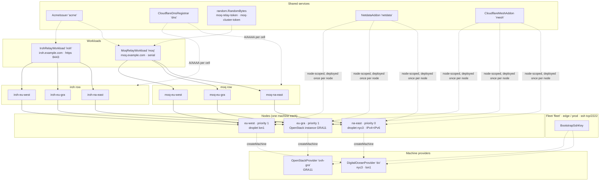
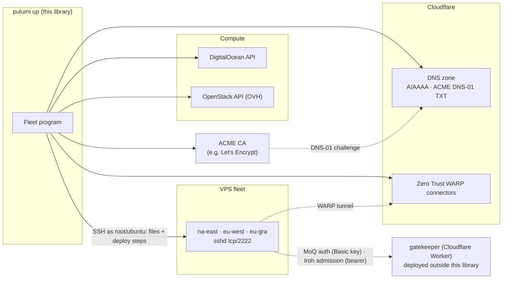
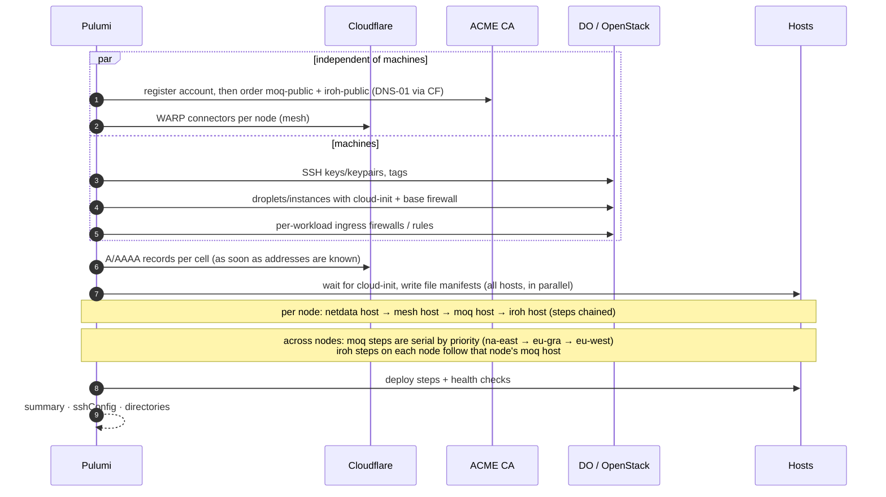
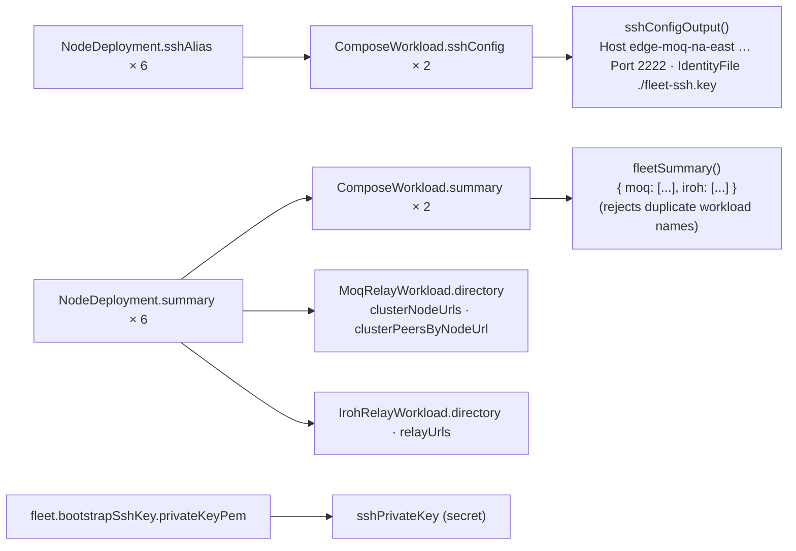

# L6 — The whole fleet

> **Zoom:** [↓ L5 Workloads](./06-workloads.md) · [⌂ Index](./README.md) · [Interactive explorer](./explorer.html)

A fleet is everything sharing one `Fleet` instance: its providers, nodes, workloads,
the shared services they consume, and the outputs aggregated from them. This page uses
one concrete example throughout. The same example is the data in
[`explorer.html`](./explorer.html).

## The example program

```ts
const fleet = new Fleet('fleet', {
  namePrefix: 'edge',
  environment: 'prod',
  ssh: { port: 2222, allowedCidrs: ['203.0.113.10/32'] }
});

// L1: providers
const digitalOcean = new DigitalOceanProvider('do', { fleet });
const ovhGra = new OpenStackProvider('ovh-gra', { fleet, region: 'GRA11' });

// L1: shared services
const dns = new CloudflareDnsRegistrar('dns', { zoneId });
const acme = new AcmeIssuer('acme', { serverUrl, dnsChallenge: { provider: 'cloudflare', apiToken } });
const netdata = new NetdataAddon('netdata');
const mesh = new CloudflareMeshAddon('mesh', { cloudflare: { accountId } });

// L3: nodes (no machines yet)
const naEast = new Node('na-east', { fleet, provider: digitalOcean, providerRegion: 'nyc3', priority: 0,
                                     hostname: 'na-east.nodes.example.com', enableIpv6: true });
const euWest = new Node('eu-west', { fleet, provider: digitalOcean, providerRegion: 'lon1', priority: 1,
                                     hostname: 'eu-west.nodes.example.com' });
const euGra  = new Node('eu-gra',  { fleet, provider: ovhGra, providerRegion: 'GRA11', priority: 1,
                                     hostname: 'eu-gra.nodes.example.com' });
const nodes = [naEast, euWest, euGra];

const authToken = new random.RandomBytes('moq-relay-token', { length: 32 });
const clusterToken = new random.RandomBytes('moq-cluster-token', { length: 32, keepers: { generation: '1' } });
const relays = nodes.map(n => ({ node: n, peers: nodes.filter(p => p !== n) }));

// L5: workloads (machines are created here, on first attach)
const moq = new MoqRelayWorkload('moq', { fleet, relays, domain: 'moq.example.com', dns, acme,
  authOrigin: 'https://gatekeeper.example.com', authToken: pulumi.secret(authToken.hex),
  clusterToken: pulumi.secret(clusterToken.hex), addons: [netdata, mesh], rollout: 'serial' },
  { dependsOn: [gatekeeperDeployment] });
const iroh = new IrohRelayWorkload('iroh', { fleet, nodes, domain: 'iroh.example.com', dns, acme,
  admissionUrl, admissionToken, ports: { https: 8443 }, addons: [netdata, mesh] });

// L6: outputs
export const summary = fleetSummary({ workloads: [moq, iroh] });
export const sshConfig = sshConfigOutput({ fleet, workloads: [moq, iroh] });
export const sshPrivateKey = pulumi.secret(fleet.bootstrapSshKey.privateKeyPem);
```

## Topology: the workload × node grid



The example produces 3 machines, 6 NodeDeployments, 6 workload ComposeHosts,
6 node-addon ComposeHosts (Netdata and Mesh on each of the 3 nodes), 2 public
certificates, 3 MoQ client identities, 3 WARP connectors, and 8 DNS records (6 A records, plus 2 AAAA records for
`na-east`, the only node with IPv6).

## Ownership tree (Pulumi parentage)

This is what `pulumi stack --show-urns` would show, using `na-east` as the expanded
example. The tree is grouped by Pulumi parent; arrows elsewhere on this page show usage.

```text
Stack
├── Fleet "fleet"
│   └── BootstrapSshKey "fleet-bootstrap-ssh"
│       └── tls.PrivateKey "fleet-bootstrap-ssh-key"
├── DigitalOceanProvider "do"
│   ├── digitalocean.SshKey "do-bootstrap"
│   └── digitalocean.Tag × (edge, edge-prod, edge-na-east, edge-eu-west)
├── OpenStackProvider "ovh-gra"
│   └── openstack.compute.Keypair "ovh-gra-bootstrap"
├── CloudflareDnsRegistrar "dns"                      (no children; records live under deployments)
├── AcmeIssuer "acme"
│   ├── acme.Provider · tls.PrivateKey (account) · acme.Registration
│   ├── acme.Certificate "moq-public"
│   └── acme.Certificate "iroh-public"
├── random.RandomBytes "moq-relay-token" · "moq-cluster-token"
├── NetdataAddon "netdata"                            (no cloud resources)
├── CloudflareMeshAddon "mesh"
│   └── per node: cloudflare.ZeroTrustTunnelWarpConnector "<machine>-connector"
├── Node "na-east"
│   ├── cloudinit.Config "na-east-cloud-init"
│   ├── MachineComponent "na-east-machine"
│   │   ├── digitalocean.Droplet "na-east-machine"
│   │   └── digitalocean.Firewall "na-east-machine-firewall"        (SSH + egress)
│   ├── digitalocean.Firewall "na-east-moq-ingress"                 (tcp/443, udp/443)
│   ├── digitalocean.Firewall "na-east-iroh-ingress"                (tcp/8443, udp/7842)
│   ├── ComposeHost "na-east-netdata-addon-host"
│   │   └── remote.Command  …-wait-cloud-init · …-files · …-deploy-netdata
│   └── ComposeHost "na-east-cloudflare-mesh-addon-host"
│       └── remote.Command  …-wait-cloud-init · …-files · …-deploy-cloudflare-mesh
├── Node "eu-west"  (same shape as na-east, but on DigitalOcean)
├── Node "eu-gra"   (OpenStack: SecGroup + SecGroupRules + Instance, ingress as SecGroupRules)
├── MoqRelayWorkload "moq"
│   └── NodeDeployment "moq-na-east"  (and moq-eu-west, moq-eu-gra)
│       ├── ComposeHost "moq-na-east-host"
│       │   └── remote.Command  …-wait-cloud-init · …-files · …-deploy-relay · …-refresh-relay-certs
│       ├── cloudflare.DnsRecord "moq-na-east-dns-a"
│       └── cloudflare.DnsRecord "moq-na-east-dns-aaaa"
└── IrohRelayWorkload "iroh"
    └── NodeDeployment "iroh-na-east" … (same shape)
```

## External systems



## What one `pulumi up` does, end to end



## Outputs



`fleetSummary` and `sshConfigOutput` are plain functions. They do not create a component
boundary.

## Secrets and where they flow

| Secret                         | Created by              | Lands in                                                        |
| ------------------------------ | ----------------------- | --------------------------------------------------------------- |
| Bootstrap SSH private key      | `BootstrapSshKey`       | ComposeHost SSH connections · `sshPrivateKey` output            |
| ACME account key               | `AcmeIssuer`            | Pulumi state only                                               |
| Public TLS private keys        | `AcmeIssuer`            | `/opt/moq/certs/public/node/privkey.pem`, `/opt/iroh/certs/privkey.pem` (0600) |
| MoQ auth key                   | `random.RandomBytes`    | container env `MOQ_AUTH_URL` (in the 0600 compose file) · gatekeeper `MOQ_RELAY_TOKEN` |
| MoQ cluster token              | `random.RandomBytes`    | `/opt/moq/secrets/cluster-token` (0600) · gatekeeper `MOQ_CLUSTER_TOKEN` |
| Iroh admission token           | stack config (input)    | container env `IROH_RELAY_HTTP_BEARER_TOKEN` (in the 0600 compose file) |
| Mesh connector token           | `CloudflareMeshAddon`   | container env `MESH_NODE_TOKEN` (in the 0600 compose file)      |
| Cloudflare DNS API token       | stack config (input)    | ACME DNS-01 challenge config                                    |

## Fleet-wide invariants

| Invariant                                                     | Enforced by                     |
| ------------------------------------------------------------- | ------------------------------- |
| Providers, nodes, and workloads share one `Fleet` instance     | providers, `ComposeWorkload`    |
| SSH never on port 22; key-only                                | `readSshAccessConfig`, cloud-init |
| Node IDs are DNS labels, unique within a workload             | `Node`, `validateNodes`         |
| Workload hostnames are unique within a workload                | `validateNodes`                 |
| One OpenStack provider per region                              | `OpenStackProvider`             |
| No port, path, or container-name collisions on a shared machine | Node claim registry            |
| Node-scoped addon deployed at most once per machine           | `Node.attachAddon`              |
| MoQ auth URLs agree with workload hostnames                   | `MoqRelayWorkload`              |
| Workload names unique in aggregated outputs                   | `fleetSummary`                  |
