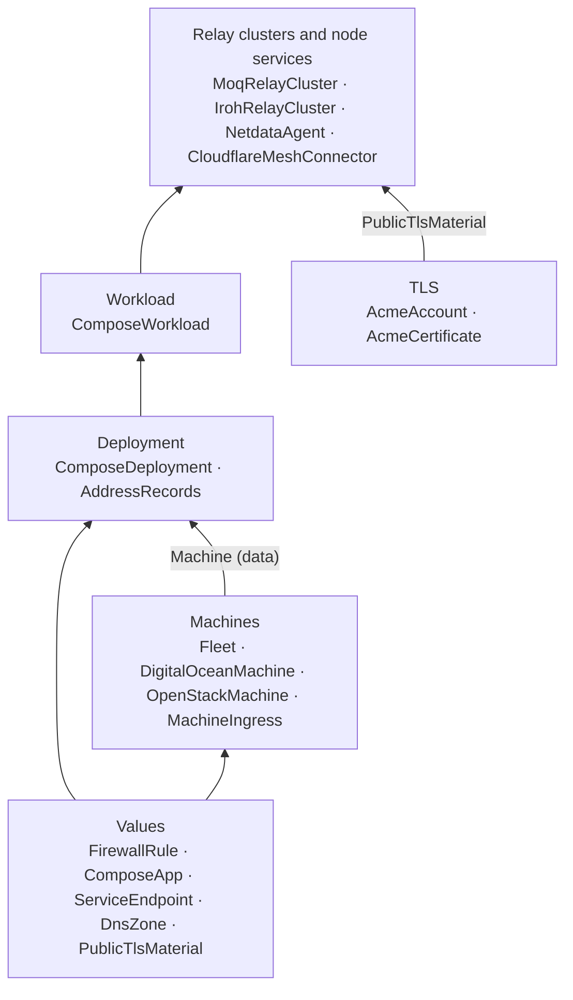

# Fleet topology

How `@moq-ha/vps-fleet` composes, layer by layer. [`COMPONENTS.md`](../../COMPONENTS.md) has the arguments; this page
covers structure: what each layer consumes, what it creates, and what ends up on a machine.



Layers only pass data upward. A deployment receives a `Machine` (connection, readiness, firewall target, claim ledger),
never the machine's provider or fleet. Nothing changes a component after it is constructed; the one shared mutable
structure is each machine's claim ledger, which can only reject a program.

## 1. Machines

`Fleet` holds naming, SSH policy and the bootstrap key. A machine component creates the VPS, its base firewall (fleet
SSH port in, everything out) and a `cloud-init-ready` command that completes once cloud-init has installed Docker and
moved sshd to the fleet port. Its outputs form the `Machine` contract.

```
DigitalOceanMachine <id>                OpenStackMachine <id>
├─ cloudinit.Config   <id>-cloud-init   ├─ cloudinit.Config        <id>-cloud-init
├─ Droplet            <id>              ├─ Keypair, SecGroup, SecGroupRules
├─ Firewall           <id>-firewall     ├─ Instance                <id>
└─ remote.Command     <id>-cloud-init-ready  └─ remote.Command     <id>-cloud-init-ready
```

`MachineIngress` adds inbound rules to an existing machine's `FirewallTarget`. It belongs to whoever creates it, so
removing a deployment removes its rules.

## 2. Deployment: one app on one machine

`ComposeDeployment` turns a `ComposeApp` into a plan at construction time: the compose file, the systemd unit and the
app's files, with their modes and change policies. It then:

1. claims the app's host listeners, paths and container names on `machine.claims` (a second owner fails the program);
2. creates a `MachineIngress` for public host endpoints plus any extra `ingress`;
3. creates the remote commands, all after `machine.ready` and the ingress;
4. creates `AddressRecords` for its hostname when given a `DnsZone`.

```
ComposeDeployment <name>
├─ MachineIngress  <name>-ingress
├─ remote.Command  <name>-files       every file, one script
├─ remote.Command  <name>-redeploy    daemon-reload, enable, pull, up --force-recreate, health gate
├─ remote.Command  <name>-restart     restart in place, health gate (only with `restart` files)
├─ remote.Command  <name>-step-<step> escape hatches, in order
└─ AddressRecords  <name>-dns         A (and AAAA)
```

On the machine:

```
/opt/<app>/docker-compose.yml   0600, compose project <app>
/opt/<app>/...                  app files
/etc/systemd/system/<app>.service   brings the project up on boot
```

`redeploy` files trigger the redeploy, `restart` files only the restart, so a certificate renewal restarts the relay
without pulling or recreating it.

## 3. Workload: one app on many machines

`ComposeWorkload` creates `<name>-<machine id>` deployments ordered by priority, then machine id. `app` may be a
function of the target, which is how relays get per-machine configuration. With `rollout: 'serial'` each deployment
depends on the previous deployment component, so it waits for every command in it, health gates included.

## 4. Relay clusters and node services

Each is a component that builds `ComposeApp`s and creates one `ComposeWorkload` as its child, forwarding its own
`dependsOn`:

```
MoqRelayCluster <name>          IrohRelayCluster <name>         NetdataAgent / CloudflareMeshConnector <name>
└─ ComposeWorkload <name>       └─ ComposeWorkload <name>       ├─ (Mesh) ZeroTrustTunnelWarpConnector per machine
   └─ ComposeDeployment ...        └─ ComposeDeployment ...     └─ ComposeWorkload <name> (target hostname = machine hostname)
```

Relay clusters take `tls` from an `AcmeCertificate` and derive their directories from the deployments' resolved
endpoints. Node services target every listed machine under its own hostname and live in `/opt/netdata` and
`/opt/cloudflare-mesh`.

## Shared machines

Several workloads may target one machine. MoQ and Iroh can share a machine once Iroh moves HTTPS off TCP 443; the
ledger compares `transport:port` listeners, absolute paths and explicit container names, so the plan fails if two
owners would collide.
