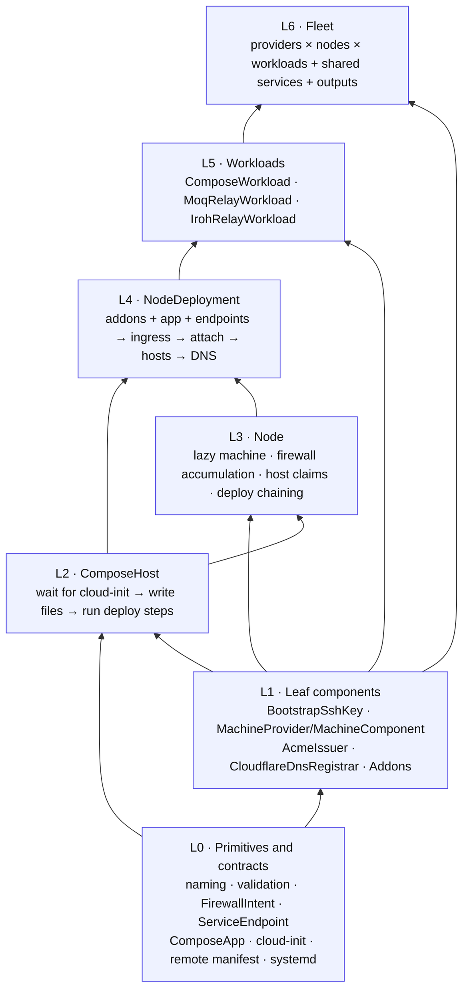
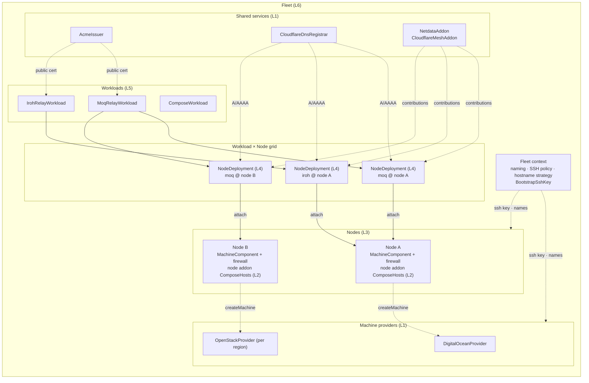

# Fleet topology, level by level

This series explains `@moq-ha/vps-fleet` from the bottom up. Each document covers one
level of composition. It shows what that level is built from (the level below) and
what builds on it (the level above), so you can start at the whole fleet and work down,
or start at a primitive and work up.

[`COMPONENTS.md`](../../COMPONENTS.md) remains the argument-by-argument API reference.
These documents focus on **structure**: what contains what, what depends on what, and
what ends up on each machine.

For an interactive view, open [`explorer.html`](./explorer.html) in a browser. It shows
the same example fleet as nested boxes. Click any group to zoom into it, use the
breadcrumb to zoom out, or switch on **Show all levels** to see the whole topology at once.

## The zoom levels

| Level  | Document                                             | Unit of composition                         | Composed into |
| ------ | ---------------------------------------------------- | ------------------------------------------- | ------------- |
| **L0** | [Primitives and contracts](./01-primitives.md)       | Values, validators, renderers (no resources) | L1–L5         |
| **L1** | [Leaf components](./02-leaf-components.md)           | Components that own only raw cloud resources | L2–L6         |
| **L2** | [ComposeHost](./03-compose-host.md)                  | One Compose project on one machine          | L3, L4        |
| **L3** | [Node](./04-node.md)                                 | One machine shared by many tenants          | L4            |
| **L4** | [NodeDeployment](./05-node-deployment.md)            | One workload on one node                    | L5            |
| **L5** | [Workloads](./06-workloads.md)                       | One application across many nodes           | L6            |
| **L6** | [The whole fleet](./07-fleet.md)                     | Every provider, node, workload, and output  | —             |

## The whole fleet in one picture

This is the L6 view, simplified. Each box links to the level that explains it.

## Two hierarchies to keep apart

The library has two different trees, and they do not line up.

1. **Ownership (Pulumi parentage)** decides where a resource sits in `pulumi stack`
   output and what is deleted with what. Machines are children of **Nodes**,
   node-scoped addon hosts are children of **Nodes**, and per-workload hosts and DNS
   records are children of **NodeDeployments**.
2. **Composition (who uses whom)** decides how the topology is assembled. A
   **Workload** creates NodeDeployments, which *attach* to Nodes, which ask a
   **MachineProvider** for a machine.

The docs follow the composition tree. Each level also includes an "ownership" note, and
[L6](./07-fleet.md#ownership-tree-pulumi-parentage) has the full ownership tree.

## Diagram conventions

- Solid arrows are construction or containment: A creates or contains B.
- Dotted arrows are data or dependency flow: A supplies something to B.
- Names in `code` are TypeScript symbols. Quoted names such as `"<machineName>-machine"`
  are Pulumi resource names.
- The examples use a fictional fleet (`edge`/`prod`, nodes `na-east`, `eu-west`, and
  `eu-gra`, domain `example.com`). [L6](./07-fleet.md) and `explorer.html` use the same
  example.
